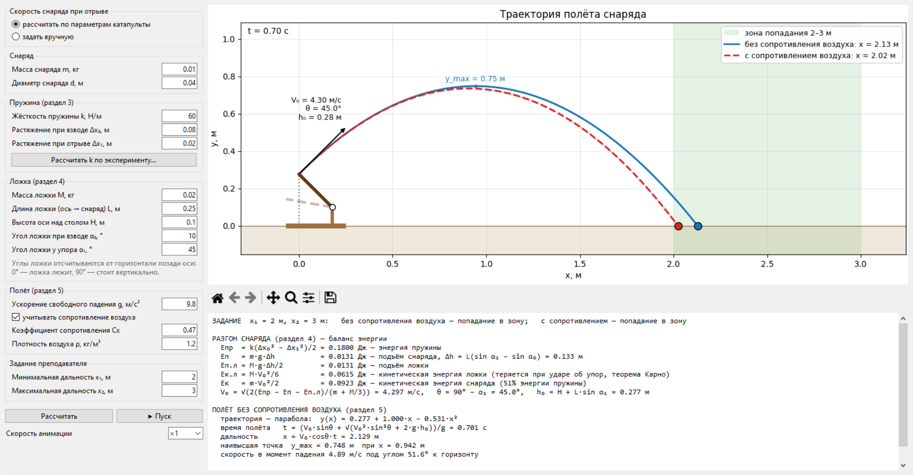

# Электронная модель катапульты

Программа к разделу 8 курсового проекта «Катапульта». По исходным данным
разделов 3–5 она рассчитывает скорость снаряда в момент отрыва от ложки и
траекторию полёта, строит график и показывает анимацию выстрела.



## Запуск

```
pip install -r requirements.txt
python app.py
```

Нужен Python 3.10+; tkinter входит в стандартную поставку Python.

## Возможности

- **Раздел 3.** Кнопка «Рассчитать k по эксперименту…» открывает таблицу опыта
  с грузами: по длине пружины без груза l₀ и парам (m_i, l_i) вычисляются
  Δl_i, F_i = m_i·g, k_i = F_i/Δl_i, среднее k, СКО и k по МНК. Среднее k
  подставляется в расчёт.
- **Раздел 4.** Скорость отрыва V₀ из баланса энергии (см. ниже). Можно также
  задать V₀, θ, h₀ вручную, например если катапульта не рычажная или скорость
  измерена.
- **Раздел 5.** Траектория без сопротивления воздуха (парабола, её уравнение,
  время и дальность полёта, наивысшая точка, скорость и угол падения) и,
  дополнительно, с сопротивлением воздуха — для оценки погрешности в разделе 7.
- Зона попадания [x₁; x₂] по заданию преподавателя и вердикт:
  попадание, недолёт или перелёт.
- Анимация: разгон ложки, затем полёт снаряда (скорость ×1 … ×0.1).
- Панель инструментов под графиком: масштаб, сдвиг, сохранение графика в PNG
  для пояснительной записки.

Все величины вводятся в СИ (кг, м, Н/м); дробную часть можно отделять как
точкой, так и запятой.

## Модель

Рычажная катапульта: ложка (однородный стержень массой M) вращается вокруг оси,
расположенной на высоте H над столом. Снаряд массой m лежит на расстоянии L от
оси. Углы ложки отсчитываются от горизонтали позади оси: α₀ — во взведённом
положении, α₁ — в момент удара об упор, когда снаряд отрывается.
Δx₀ и Δx₁ — растяжение пружины (резинки) во взведённом положении и в момент
отрыва.

**Разгон (раздел 4).** Энергия пружины расходуется на подъём снаряда и ложки
и на их разгон:

    k(Δx₀² − Δx₁²)/2 = m·g·Δh + M·g·Δh/2 + m·V₀²/2 + M·V₀²/6,
    Δh = L(sin α₁ − sin α₀)

Слагаемое M·V₀²/6 = I·ω²/2 (I = M·L²/3, ω = V₀/L) — кинетическая энергия ложки,
которая по теореме Карно теряется при ударе об упор. Отсюда

    V₀ = √(2(Eпр − m·g·Δh − M·g·Δh/2) / (m + M/3)),
    θ = 90° − α₁,   h₀ = H + L·sin α₁

(снаряд вылетает по касательной к окружности, которую описывает конец ложки).

**Полёт (раздел 5).** Начало координат — на столе под точкой отрыва:

    x(t) = V₀·cosθ·t,   y(t) = h₀ + V₀·sinθ·t − g·t²/2
    t_пол = (V₀·sinθ + √(V₀²·sin²θ + 2·g·h₀)) / g,   x_пол = V₀·cosθ·t_пол
    y(x) = h₀ + x·tgθ − g·x² / (2·V₀²·cos²θ)

С сопротивлением воздуха F = ½·ρ·Cx·S·v² (S = πd²/4, для шара Cx ≈ 0.47)
уравнения движения интегрируются численно методом Рунге — Кутты 4-го порядка.

## Файлы

- `physics.py` — расчётная часть (разделы 3–5), без интерфейса;
- `app.py` — окно программы: ввод данных, график, анимация, отчёт.
