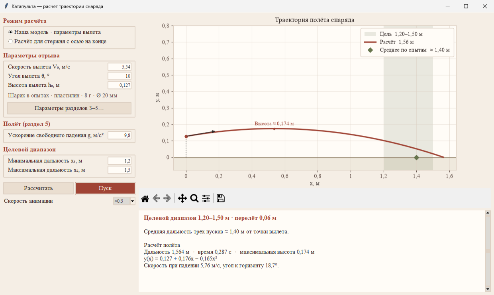

# Электронная модель катапульты

Настольное приложение к разделу 8 курсового проекта по механике. Оно строит траекторию пластилинового шарика, показывает анимацию и позволяет сравнить результат расчёта с данными опытов команды.



## Запуск

Понадобится Python 3.10 или новее с поддержкой Tkinter. Выполните команды из папки с `app.py`.

```bash
python -m pip install -r requirements.txt
python app.py
```

## Что показано при запуске

Программа сразу строит график для модели команды. Параметры вылета по умолчанию — скорость 5,54 м/с, угол 10° и высота 0,127 м. В опытах использовался пластилиновый шарик массой 8 г и диаметром 20 мм.

На скриншоте расчётная дальность составляет 1,564 м. Зелёный маркер показывает среднюю дальность трёх опытов (около 1,40 м), а затенённая область — диапазон задания 1,20–1,50 м. Дальности отсчитываются от проекции точки вылета на поверхность.

## Режимы расчёта

| Режим в программе | Как задаются параметры |
| --- | --- |
| **Наша модель · параметры вылета** | Скорость, угол и высоту можно ввести в главном окне. В диалоге «Параметры разделов 3–5…» кнопка «Применить и рассчитать» вычисляет скорость по балансу энергии для ложки с осью внутри стержня и обновляет график. Угол и высота берутся из полей диалога. |
| **Расчёт для стержня с осью на конце** | Параметры вылета вычисляются из введённых данных для пружины, ложки и шарика. В этом режиме анимация показывает поворот ложки перед полётом. |

В обоих режимах доступен расчёт жёсткости по замерам раздела 3. В таблице выводятся значения для отдельных замеров, среднее, стандартное отклонение и оценка методом наименьших квадратов. Кнопка «Подставить среднее k» переносит среднее в соответствующее поле.

## График и отчёт

1. После изменения полей нажмите «Рассчитать». Единицы измерения указаны рядом с полями. Дробную часть можно отделять запятой или точкой.
2. Под графиком показаны уравнение параболы, время и дальность полёта, максимальная высота, скорость и угол при падении. Там же указано, входит ли расчётная дальность в диапазон задания. Полёт рассчитывается без учёта сопротивления воздуха.
3. Кнопка «Пуск» запускает анимацию. Скорость воспроизведения меняется от ×0,1 до ×1. Кнопка с дискетой на панели графика сохраняет изображение для пояснительной записки.

## Файлы

- `app.py` — интерфейс, график, анимация и отчёт.
- `physics.py` — расчёт жёсткости, параметров вылета и траектории.
- `requirements.txt` — зависимости NumPy и Matplotlib.
